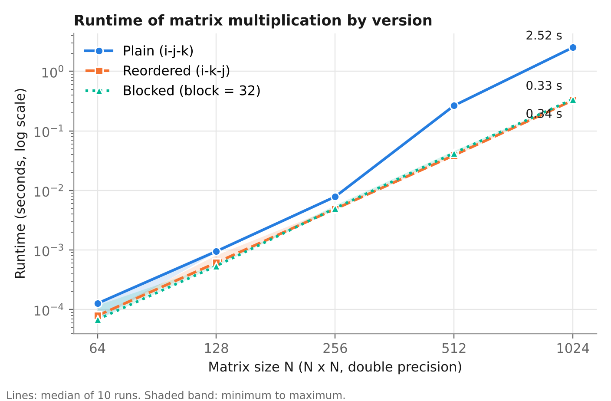
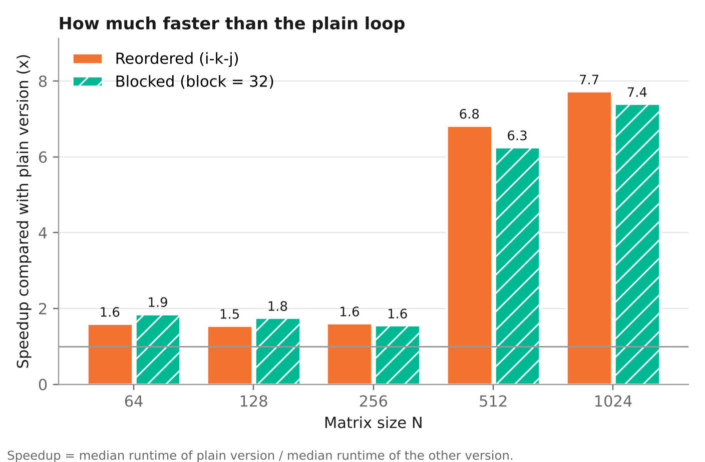
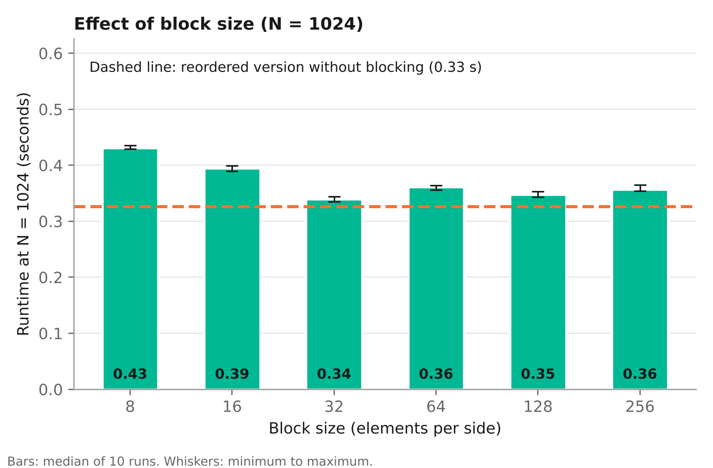

# Cache Effects on Matrix Multiplication: Loop Order and Blocking

Code, raw measurements and reproduction instructions for a small empirical study.
Student Research Challenge, Architecture of Computers (Winter 2026/2027).

- **Author:** SeifEldin Hassan (Student ID 81362)
- **Repository:** https://github.com/SeifEldinHassan/matmul-cache-study

## Research question

How much do loop order and blocking (tiling) change the runtime of dense matrix
multiplication on a laptop CPU, and how does this change with matrix size?

## What the program does

`matmul_bench.c` multiplies two N x N matrices of `double` values (row-major storage) in
three ways and measures the runtime of each:

| Version | Description |
|---|---|
| `ijk` (plain) | Textbook loop order i-j-k. The inner loop reads matrix B down a column. |
| `ikj` (reordered) | Same arithmetic with loop order i-k-j. The inner loop reads rows of B and C. |
| `blocked` | Tiled version that works on BS x BS sub-blocks (default BS = 32). |

Before measuring each size, the program checks that the `ikj` and `blocked` results match
the `ijk` result (maximum absolute difference below 1e-9). Time is measured with the Windows
`QueryPerformanceCounter` (on other systems `clock_gettime`). Every setting is run 10 times.

## Files

| File | Description |
|---|---|
| `matmul_bench.c` | Benchmark program (C). |
| `results_sizes.csv` | Raw timings: N = 64, 128, 256, 512, 1024; block size 32; 10 runs per version. |
| `results_blocks.csv` | Raw timings: N = 1024; block sizes 8, 16, 32, 64, 128, 256; 10 runs each. |
| `summary_table.csv` | Medians, means, standard deviations, minimum, maximum and speedups. |
| `make_charts.py` | Python script that reads the two CSV files and creates the table and charts. |
| `fig1_runtime_vs_size.png` | Runtime against matrix size. |
| `fig2_speedup.png` | Speedup of `ikj` and `blocked` compared with the plain version. |
| `fig3_block_size.png` | Runtime against block size at N = 1024. |

CSV columns: `version,N,block,run,seconds`. Lines starting with `#` are comments
(settings and correctness checks).

## Test machine

| Item | Value |
|---|---|
| CPU | 13th Gen Intel Core i7-13620H (10 cores, 16 threads, base 2.4 GHz) |
| Cache (totals shown by Windows Task Manager) | L1 864 KB, L2 9.5 MB, L3 24 MB |
| RAM | 16 GB (15.6 GB usable) |
| Operating system | Windows 11 |
| Compiler | GCC 16.2.0 (w64devkit) |
| Compiler flags | `-O2` |

The CPU has performance and efficiency cores, and the program may run on either kind.
There was no CPU frequency pinning and no core pinning. Other programs were closed during
the runs.

## How to reproduce

1. Install a C compiler. On Windows, download w64devkit from
   https://github.com/skeeto/w64devkit/releases and run `w64devkit.exe`.
2. Open a shell in the folder with the files and compile:

   ```
   gcc -O2 -o matmul_bench matmul_bench.c -lm
   ```
3. Run the experiments. Arguments are: number of runs, largest N, and block size
   (or the word `blocks` for the block-size sweep):

   ```
   ./matmul_bench.exe 10 1024 32 > results_sizes.csv
   ./matmul_bench.exe 10 1024 blocks > results_blocks.csv
   ```
   The size sweep takes a few minutes. Keep the laptop plugged in and avoid other work
   while it runs.
4. Create the table and charts (Python 3 with `matplotlib`):

   ```
   python make_charts.py
   ```

## Results summary (median of 10 runs, seconds)

| N | Plain `ijk` | Reordered `ikj` | Blocked (32) | Speedup `ikj` | Speedup blocked |
|---|---|---|---|---|---|
| 64 | 0.000126 | 0.000079 | 0.000068 | 1.60 | 1.86 |
| 128 | 0.000948 | 0.000612 | 0.000540 | 1.55 | 1.76 |
| 256 | 0.007857 | 0.004872 | 0.005045 | 1.61 | 1.56 |
| 512 | 0.266050 | 0.038965 | 0.042508 | 6.83 | 6.26 |
| 1024 | 2.523029 | 0.326330 | 0.340888 | 7.73 | 7.40 |

Speedup = median runtime of the plain version divided by the median runtime of the
other version.

Block-size sweep at N = 1024 (median of 10 runs, seconds):

| Block size | 8 | 16 | 32 | 64 | 128 | 256 |
|---|---|---|---|---|---|---|
| Runtime | 0.4313 | 0.3945 | 0.3392 | 0.3609 | 0.3474 | 0.3567 |





## Limitations

- One machine, one compiler and one set of compiler flags, one data type (`double`).
- No hardware performance counters were used, so cache misses were not measured directly.
- Runs at N = 64 last only about 0.1 ms and are less reliable.
- Sizes are powers of two, which may cause cache-set conflicts. Other sizes were not tested.
- Results on other CPUs, compilers or settings may differ.

## AI assistance

The benchmark program, the chart script and this README were drafted with the help of an AI
assistant (Claude, by Anthropic). The author compiled and ran the program, collected all
measurements on the machine described above, and is responsible for the content.
